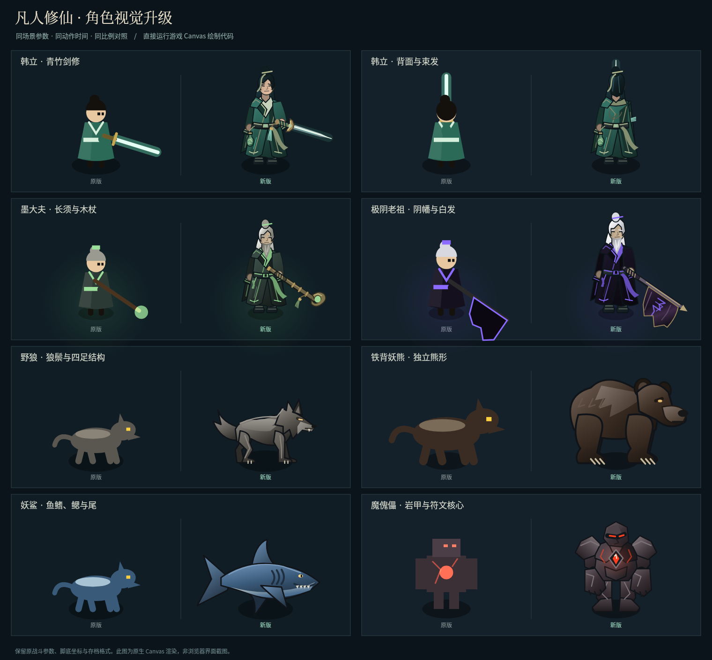

# 凡人修仙 · 仙途

致敬《凡人修仙传》（忘语）的单文件 HTML 动作打怪升级游戏，包含人界、灵界试炼与仙界篇。

- `index.html`：游戏本体，Canvas 2D，纯前端、无运行时依赖；进度保存在浏览器 localStorage。
- `deploy.sh`：复制到 `~/fanren-game`，并确保 8090 端口的 busybox httpd 在运行。
- `docs/character-upgrade-comparison.png`：角色升级前后对照。
- `docs/visual-verification.json`：本轮验证范围、结果、源码哈希及原生 Canvas 绘制耗时。

## 运行

直接用浏览器打开 `index.html`，或在项目目录运行静态 HTTP 服务。服务器原有部署方式：

```sh
./deploy.sh
```

操作：WASD 移动 · 鼠标瞄准 · 左键/J 攻击 · 右键/L 蓄力 · 空格/K 闪避 · U I O P R T G 法术 · E 服丹 · Tab 锁定 · Esc 暂停。

## 角色视觉升级 · 2026-11-22



| 对象 | 造型更新 |
|---|---|
| 韩立 | 修长头身比例、束发、交领青袍、分层衣摆、腰封、掌天瓶、金属剑刃及剑穗 |
| 人形修士与首领 | 帮众短衣、天庭甲胄、墨大夫灰发长须与木杖、王蝉血色冠饰、极阴老祖白发魂幡等独立造型 |
| 妖兽与魔灵 | 狼、熊、鲨独立轮廓；蜘蛛关节、蟹壳与双钳、蛇腹与蛟鳞、阴魂面甲与飘带、岩傀符核、魔头双角胸甲和利爪 |
| 武器 | 剑、刀、斧、弓、杖、枪、魂幡七类武器增加刃面、握柄、金属与饰物细节 |
| 动作与法相 | 衣摆、发尾、步态、武器动作及前后遮挡；三头六臂使用统一的头部与肩部锚点 |

造型直接用于游戏中的角色、闪避残影和法相，所有图形随 Canvas 缩放，不需要下载图片或模型。

### 人物志

标题和洞府都有「人物志」入口，可查看 **54 个角色**，按修士、妖兽、魔灵分类，切换静立、行走、出招及四个朝向。人物志使用独立预览对象，查看不会消耗资源或改变存档。

### 验证

- **1,528 个游戏渲染组合**通过，覆盖 43 个普通怪、10 位首领及韩立的多境界、动作和法相。
- **1,296 个人物志渲染组合**通过：54 角色 × 3 动作 × 4 朝向 × 2 个预览区域尺寸。
- 第一章和北寒地图的移动、攻击、蓄力、闪避、暂停恢复，以及旧存档加载和写回通过。
- Canvas 状态栈、透明度和合成模式无泄漏；法相三头六臂及暗地、雪地上的角色轮廓经过图像检查。
- 核心角色数据、存档、地图、战斗判定和 AI 代码段与升级前一致。

验证环境为 Node VM 执行生产 JavaScript、原生 Skia Canvas 绘制及事件模拟。当前执行环境限制 Chromium 启动，因此上述结果不包含浏览器 CSS 布局、浏览器帧率或移动设备性能认证。完整口径与耗时见验证报告。
