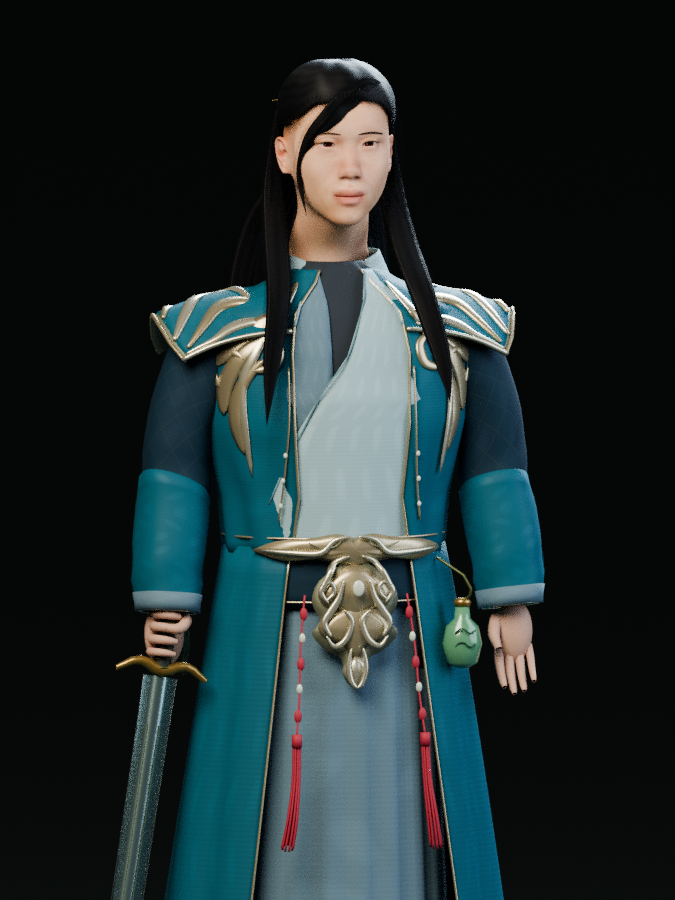
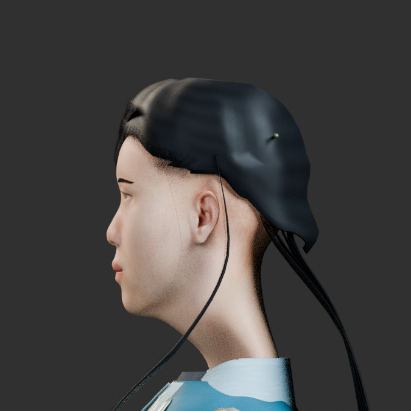

# 凡人修仙 · 仙途

动作修仙游戏。`index.html` 为 Canvas 2D 主流程，包含人界、灵界试炼、仙界篇与人物志；`game3d.html` 为独立的 Three.js 3D 山门试剑。

## 当前版本 · 2026-11-22

**韩立 revision 6 + runtime 1**：接续完成待发布的人物资产，修复侧面颈部穿领，并修正战斗结算、闪避和多来源输入。3D 当前是韩立对墨蛟的单场可编辑原型；完整 3D 剧情、生产级面部/布料以及实机性能仍待推进。

入口：[3D 试炼](http://23.82.99.226:8090/game3d.html?v=20261122-character6-runtime1) · [韩立半身](http://23.82.99.226:8090/game3d.html?v=20261122-character6-runtime1&view=hero&frame=portrait) · [韩立头部](http://23.82.99.226:8090/game3d.html?v=20261122-character6-runtime1&view=hero&frame=head) · [墨蛟](http://23.82.99.226:8090/game3d.html?v=20261122-character6-runtime1&view=beast&frame=head)。当前发布状态以 [交接记录](HANDOFF.md) 和 [部署核验](docs/runtime-release-delivery.json) 为准。

| 系统 | 当前能力 |
|---|---|
| 3D 场景 | 演武台、山门、松竹、远山、雾、灯火、旗帜与粒子 |
| 韩立 | CC0 解剖头部与皮肤贴图、分层长发和透明裁切发卡、蓝青长袍、冰蓝衣领、肩腰饰、掌天瓶和长剑 |
| 墨蛟 | 四足、角须、牙列、鳞甲、长尾；分层关节动作 |
| 角色观察 | 独立展台、全身/半身/头部、自动环绕、头部动作跟随、静立/行走/攻击 |
| 战斗 | 镜头相对移动、斩击、剑芒、闪避、法力/冷却、追击/蓄势/扑击、胜负与重试 |
| 输入 | 键盘和多个触点独立持有方向；失焦、隐藏页面、返回缓存前自动暂停，回来后手动恢复 |
| 2D | 54 角色人物志、修炼/地图/战斗与浏览器存档；与 3D 试炼独立 |

3D 操作：**WASD** 移动 · **J / 左键** 斩击 · **Q** 剑芒 · **空格 / K** 闪避 · **右键拖动** 环绕 · **滚轮** 拉近 · **Esc** 暂停。触屏提供移动与战斗按钮。

## 本轮人物资产

下面是**最终游戏 GLB 重新导入 Blender 后的 CPU 渲染**。图片与最终模型哈希绑定，未作为浏览器截图或帧率证据。

| 韩立半身 | 侧面衣领修复 |
|---|---|
|  |  |

| 资产 | 文件字节 | 三角面 | 材质分片 | 内嵌纹理 | 动作接口 |
|---|---:|---:|---:|---:|---|
| 韩立 | 16,520,736 | 268,652 | 29 | 15 | 21 骨骼，Idle / Walk / Attack |
| 墨蛟 | 2,738,712 | 98,226 | 10 | 3 | 分层关节，Idle / Walk / Attack |

韩立 GLB SHA256：`e410803590a90e19e9d3f1182f07a523c50187717bde56162394d57487b591d2`。源 `.blend`、构建脚本、MakeHuman 来源文件及哈希见 [资产清单](assets/3d/hanli-info.json) 和 [来源说明](art/source/makehuman/README.md)。只收紧衣领下方后侧低颈部，修复原侧面约 5–10 mm 的皮肤穿出；脸部高于 1.445 m 的坐标、非皮肤网格及动作采样保持一致。

相对 revision 5，韩立三角面增加约 48.3%，文件增加约 86.4%；浏览器 GPU、CSS 和手机帧率尚未验收。发卡透明裁切、纹理解码、蒙皮和动作数值已经检查。面部神态、发型体积、服装折面与移动重量感仍有提升空间。

## 本轮战斗修复

| 原问题 | 当前行为 |
|---|---|
| 击杀后仍显示残余血条 | 斩击和剑芒的致命帧同步血条、清动作，只结算一次 |
| 闪避结束后补发旧斩击 | 闪避取消未完成的斩击；闪避期间不能覆盖成施法动作 |
| 重试或同帧按键时闪避方向陈旧 | 闪避即时读取当前输入和相机方向；无输入按当前朝向 |
| 键盘/触屏、多指相互误清 | 每个输入来源独立释放，最后一个来源松开才停止 |
| 点击当前演武场标签重置战斗 | 保留当前血量、法力、战斗与暂停状态 |
| 页面隐藏未触发 blur 时继续战斗 | visibilitychange 和 pagehide 都暂停并清旧输入 |

## 运行与重建

3D 依赖 ES modules 和 GLB 请求，需要 HTTP 服务；项目自带 Three.js 0.180.0，不依赖运行时 CDN。

```sh
./deploy.sh
# 默认发布到 ~/fanren-game，使用现有 8090 端口。
```

Blender 4.3.2 已验证；源资产随仓库提供，可离线重建：

```sh
FANREN_SKIP_RENDER=1 blender -b --factory-startup --python tools/build_hanli.py
blender -b --factory-startup --python tools/build_mojiao.py
```

`tools/hanli_face.py`、`hanli_hair.py`、`hanli_costume.py` 分别构建面部、头发和服装。重建后须重新运行验证并渲染最终 GLB，不能沿用旧模型的图片与报告。

## 验收

Node.js 20+，CPU 检查使用 `@napi-rs/canvas`。四项 CPU/逻辑验证已通过；它们不创建 WebGL 上下文。

```sh
node tools/validate-assets.mjs docs/asset-validation.json
node tools/validate-model-polish.mjs docs/model-polish-verification.json
node tools/validate-viewer.mjs docs/viewer-verification.json
node tools/validate-collar.mjs docs/collar-verification.json
```

| 证据 | 结果与范围 |
|---|---|
| [资产验证](docs/asset-validation.json) | PASS；两模型、18 张内嵌纹理、发卡裁切、骨骼与完整属性 |
| [动作验证](docs/model-polish-verification.json) | PASS；60 Hz 脚底、150 个全模型时刻、248 个原过渡时刻、96 组/2,592 时刻步态过渡 |
| [观察与战斗](docs/viewer-verification.json) | PASS；10 组模型/视口取景、25 轮切换、新增 14 组战斗/输入回归；DOM 为确定性测试数据 |
| [领口定点回归](docs/collar-verification.json) | PASS 7/7；右后颈已知缺陷区域，默认姿态射线检查 |
| [最终GLB渲染](docs/hanli-v6-render-manifest.json) | 13 张独立图：静态七视角及四个关键动作，另保留兼容预览文件名 |
| [真实浏览器](docs/browser-verification.json) | BLOCKED；Chromium 在导航前因 socket 权限失败，未取得 WebGL/CSS/FPS 结果 |
| [总体清单](docs/3d-verification.json) | 当前源码、模型、CPU 验证与离线渲染绑定 |

真实浏览器检查已固化成可重跑工具，需 Playwright 和可启动的 Chromium。启动受阻返回 2，页面或断言失败返回 1，全部通过返回 0：

```sh
FANREN_CHROMIUM_PATH=/usr/bin/chromium node tools/validate-browser.mjs
```

2D 既有验证：1,528 个游戏渲染组合、1,296 个人物志组合，以及移动/战斗/暂停/存档检查；详见 [原验收报告](docs/visual-verification.json)。历史人物模型对照仍保留在 `docs/hanli-v5-comparison.jpg`，其标签对应 revision 4→5。
