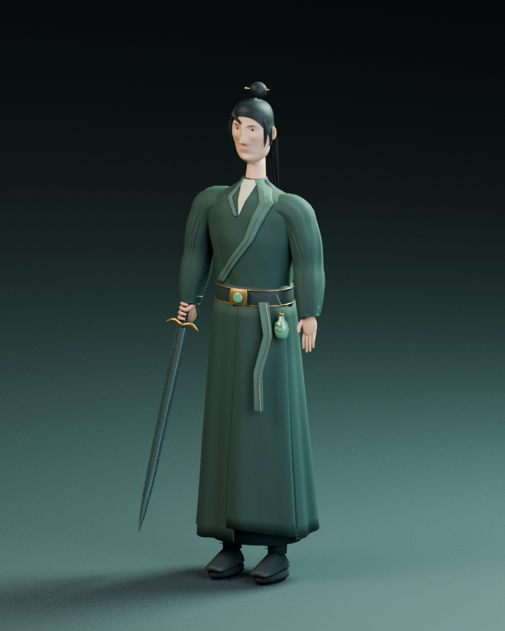
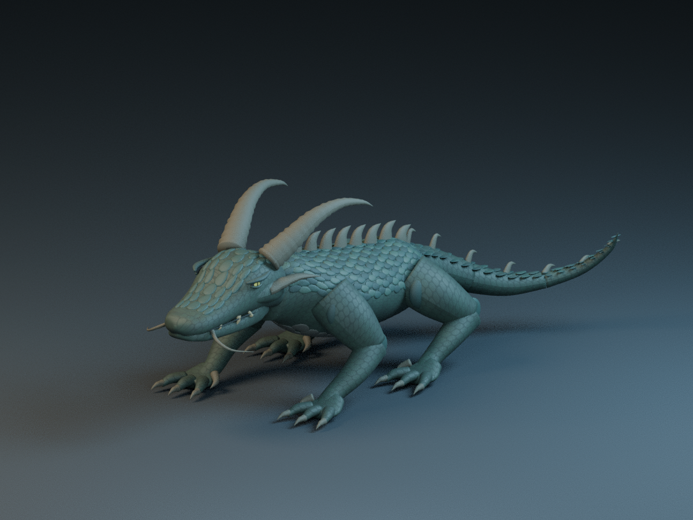
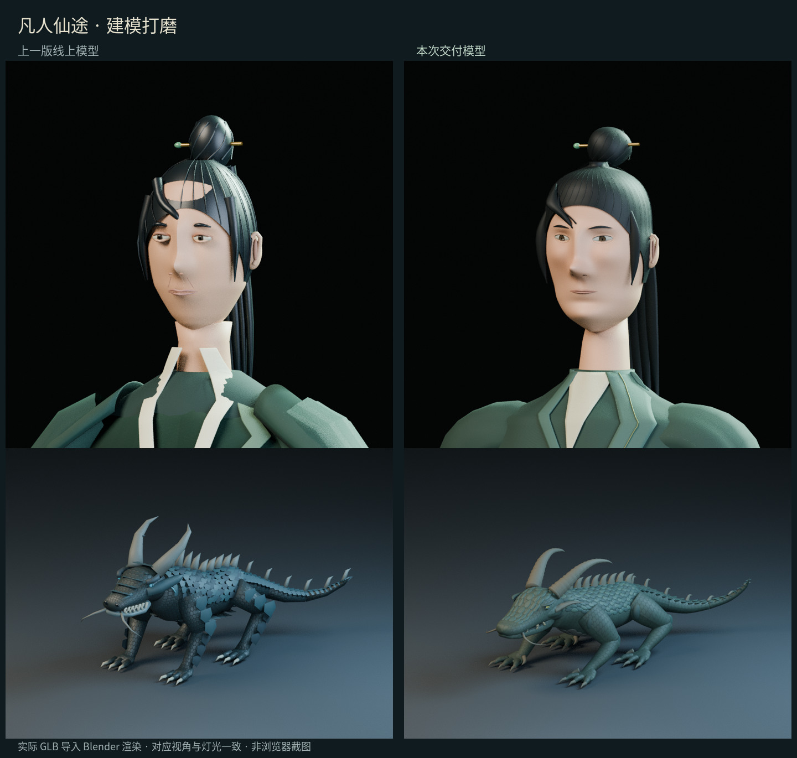

# 凡人修仙 · 仙途

致敬《凡人修仙传》（忘语）的动作修仙游戏。2D 版包含人界、灵界试炼与仙界篇；新增独立的 Three.js 3D 山门试炼原型。

- `index.html`：游戏本体，Canvas 2D，纯前端、无运行时依赖；进度保存在浏览器 localStorage。
- `game3d.html`：Three.js 3D 山门试炼，包含韩立、墨蛟与角色观察模式。
- `web3d/`、`assets/3d/`、`vendor/three/`：3D 场景、战斗逻辑、GLB 模型与本地 Three.js r180 依赖。
- `art/hanli.blend`、`art/mojiao.blend`：可编辑的 Blender 模型、材质及动画源文件。
- `deploy.sh`：复制到 `~/fanren-game`，并确保 8090 端口的 busybox httpd 在运行。
- `docs/character-upgrade-comparison.png`：角色升级前后对照。
- `docs/visual-verification.json`：本轮验证范围、结果、源码哈希及原生 Canvas 绘制耗时。

## 运行

直接用浏览器打开 `index.html`，或在项目目录运行静态 HTTP 服务。服务器原有部署方式：

```sh
./deploy.sh
```

操作：WASD 移动 · 鼠标瞄准 · 左键/J 攻击 · 右键/L 蓄力 · 空格/K 闪避 · U I O P R T G 法术 · E 服丹 · Tab 锁定 · Esc 暂停。

## 3D 山门试剑 · 2026-11-22

从 2D 标题页点击「3D 山门试剑」，或通过静态 HTTP 服务打开 `game3d.html`。3D 版使用 ES modules 和模型请求，需要 HTTP 服务，不能直接以 `file://` 打开。

当前交付是**单场战斗的可编辑 3D 原型**，用于打通 Blender → GLB → Three.js 资产与玩法链路。它有程序化造型特征，面部、衣料、毛发、鳞甲与动作质量尚未达到 3A 成品标准；后续美术可以继续编辑 `.blend` 或替换同接口的 GLB。

| 内容 | 已实现 |
|---|---|
| 场景 | 石质演武台、山门、残栏、松竹、远山、雾、灯火、动态旗帜与粒子 |
| 韩立 | 交领青袍、束发、长剑、掌天瓶、21 骨骼蒙皮，静立/行走/攻击 |
| 墨蛟 | 四足、角须、牙列、爪、鳞甲、长尾，分层关节变换动画 |
| 观察 | 独立布光展台、全身/头部近景、自动环绕、动画头部跟随、三种动作预览 |
| 战斗 | 镜头相对移动、斩击、剑芒、闪避、法力消耗恢复、敌人追击与蓄势扑击、胜负与重试 |
| 输入 | 键鼠、触屏移动与战斗按钮、失焦自动暂停及点击恢复 |
| 渲染 | PBR 材质、内嵌纹理、环境照明、实时阴影、ACES 色调映射、分辨率档位 |

3D 操作：**WASD** 移动 · **J / 左键** 斩击 · **Q** 剑芒 · **空格 / K** 闪避 · **右键拖动** 环绕 · **滚轮** 拉近 · **Esc / 暂停按钮** 暂停恢复。当前试炼独立运行，不读取或写入 2D 修仙存档。

### 模型源文件与真实渲染

下图将本次交付的 GLB 重新导入 Blender 后进行 CPU 渲染，展示游戏资产本身；不是网页运行截图。

| 韩立 | 墨蛟 |
|---|---|
|  |  |

| 资产 | GLB 大小 | 三角面 | 运行时结构 |
|---|---:|---:|---|
| `hanli.glb` | 5,937,792 字节 | 138,232 | 24 个材质分片、21 骨骼、5 张内嵌纹理 |
| `mojiao.glb` | 2,738,712 字节 | 98,226 | 56 个网格、分层关节动画、3 张内嵌纹理 |

两份 GLB 都以米为单位，Y 向上、+Z 为正面，脚底位于地面附近；统一提供 `Idle`、`Walk`、`Attack` 动作。所有纹理与缓冲均内嵌，无外部资产请求。场景文件由代码生成；角色保留真实 `.blend` 源文件。Three.js 固定为 0.180.0，MIT 许可证见 `vendor/three/LICENSE`。

### 重新生成资产

已在 Blender **4.3.2** 验证。项目根目录执行：

```sh
blender -b --factory-startup --python tools/build_hanli.py
blender -b --factory-startup --python tools/build_mojiao.py
```

脚本会重建 `art/*.blend` 与 `assets/3d/*.glb`，并在项目旁的 `qa3d/` 输出预览与统计。韩立脚本可设置 `FANREN_SKIP_RENDER=1` 只生成资产，或通过 `FANREN_QA_DIR` 指定预览目录。也可直接用 Blender 打开 `.blend`，编辑后按上述坐标和动作接口导出 GLB。

### 本轮建模打磨



- **韩立**：补齐领口封闭面，交领改为逐点贴合衣身的曲面；肩袖埋入衣身并平滑分配蒙皮权重。重做眉弓、眼窝、鼻翼、颧骨和下颌结构，使用贴合眼睑的虹膜/瞳孔表面；鬓发和额发改为连续曲线发束。增加皮肤肤色与粗糙度纹理，保留可编辑骨骼、握剑手、分层衣摆、掌天瓶和三种动作。
- **墨蛟**：保留贴合背鳞、口鼻与角根连接、脚掌接地的上一轮改进；修复尾巴动画首尾相位不一致造成的循环跳动。
- **法线贴图**：修复外袍封口、裙摆厚边以及妖兽圆环端盖退化 UV，19 个使用法线贴图的网格均有有效切线坐标。
- **观察体验**：中性展台与独立主光/补光/轮廓光；全身、头部近景、自动环绕可切换。近景跟随真实头部动画，返回演武场恢复原灯光、相机和战斗状态。

在线入口：[3D 试炼](http://23.82.99.226:8090/game3d.html)、[韩立近景](http://23.82.99.226:8090/game3d.html?view=hero&frame=head)、[墨蛟近景](http://23.82.99.226:8090/game3d.html?view=beast&frame=head)。头部静帧：[韩立](docs/hanli-head-preview.png)、[墨蛟](docs/mojiao-head-preview.png)。

### 3D 验证范围

- 两份 `.blend` 重新打开成功；最终 GLB 重新导入后完成全身和头部 CPU 渲染，韩立另检查背面。
- 原版 Three.js r180 `GLTFLoader`、`AnimationMixer` 加载两份 GLB，8 张内嵌纹理解码、颜色空间、法线、UV、索引、骨骼矩阵和全部蒙皮权重通过。
- 脚掌按 60 Hz 检查 **727 个时刻**；另做 **150 个全模型时刻**与 **248 个动画过渡时刻**检查。两模型无穿地，Idle/Walk 首尾顶点差不超过 0.0000002 米。
- 韩立行走中最低脚掌最高离地约 2.4 厘米；当前走路动画尚未实现物理脚锁与完整重量转移。
- 两模型 × 五组视口矩形 × 24 个环绕方位通过取景投影检查；25 轮观察/战场切换无场景节点增长，头部动画跟随与战斗状态回归通过。
- 本地 Chromium 在启动阶段因 `socket() failed: Operation not permitted` 退出；**上述相机与界面矩形测试不包含真实浏览器 CSS、GPU 画面或实机帧率验收**。

总报告见 `docs/3d-verification.json`；细项证据分别在 `docs/asset-validation.json`、`docs/model-polish-verification.json`、`docs/viewer-verification.json`。验证命令需要 Node.js 20+ 与 `@napi-rs/canvas`，不创建 WebGL 上下文：

```sh
node tools/validate-assets.mjs docs/asset-validation.json
node tools/validate-model-polish.mjs docs/model-polish-verification.json
node tools/validate-viewer.mjs docs/viewer-verification.json
```

重新检查运行时模型的真实渲染：

```sh
blender -b --factory-startup --python tools/render_glb_review.py -- \
  --studio art/hanli.blend --asset assets/3d/hanli.glb \
  --output-dir ../qa3d/glb-review --name hanli --views full head back
```

## 角色视觉升级 · 2026-11-22


| 对象 | 造型更新 |
|---|---|
| 韩立 | 修长头身比例、束发、交领青袍、分层衣摆、腰封、掌天瓶、金属剑刃及剑穗 |
| 人形修士与首领 | 帮众短衣、天庭甲胄、墨大夫灰发长须与木杖、王蝉血色冠饰、极阴老祖白发魂幡等独立造型 |
| 妖兽与魔灵 | 狼、熊、鲨独立轮廓；蜘蛛关节、蟹壳与双钳、蛇腹与蛟鳞、阴魂面甲与飘带、岩傀符核、魔头双角胸甲和利爪 |
| 武器 | 剑、刀、斧、弓、杖、枪、魂幡七类武器增加刃面、握柄、金属与饰物细节 |
| 动作与法相 | 衣摆、发尾、步态、武器动作及前后遮挡；三头六臂使用统一的头部与肩部锚点 |

造型直接用于游戏中的角色、闪避残影和法相，所有图形随 Canvas 缩放，不需要下载图片或模型。

### 人物志

标题和洞府都有「人物志」入口，可查看 **54 个角色**，按修士、妖兽、魔灵分类，切换静立、行走、出招及四个朝向。人物志使用独立预览对象，查看不会消耗资源或改变存档。

### 验证

- **1,528 个游戏渲染组合**通过，覆盖 43 个普通怪、10 位首领及韩立的多境界、动作和法相。
- **1,296 个人物志渲染组合**通过：54 角色 × 3 动作 × 4 朝向 × 2 个预览区域尺寸。
- 第一章和北寒地图的移动、攻击、蓄力、闪避、暂停恢复，以及旧存档加载和写回通过。
- Canvas 状态栈、透明度和合成模式无泄漏；法相三头六臂及暗地、雪地上的角色轮廓经过图像检查。
- 核心角色数据、存档、地图、战斗判定和 AI 代码段与升级前一致。

验证环境为 Node VM 执行生产 JavaScript、原生 Skia Canvas 绘制及事件模拟。当前执行环境限制 Chromium 启动，因此上述结果不包含浏览器 CSS 布局、浏览器帧率或移动设备性能认证。完整口径与耗时见验证报告。
